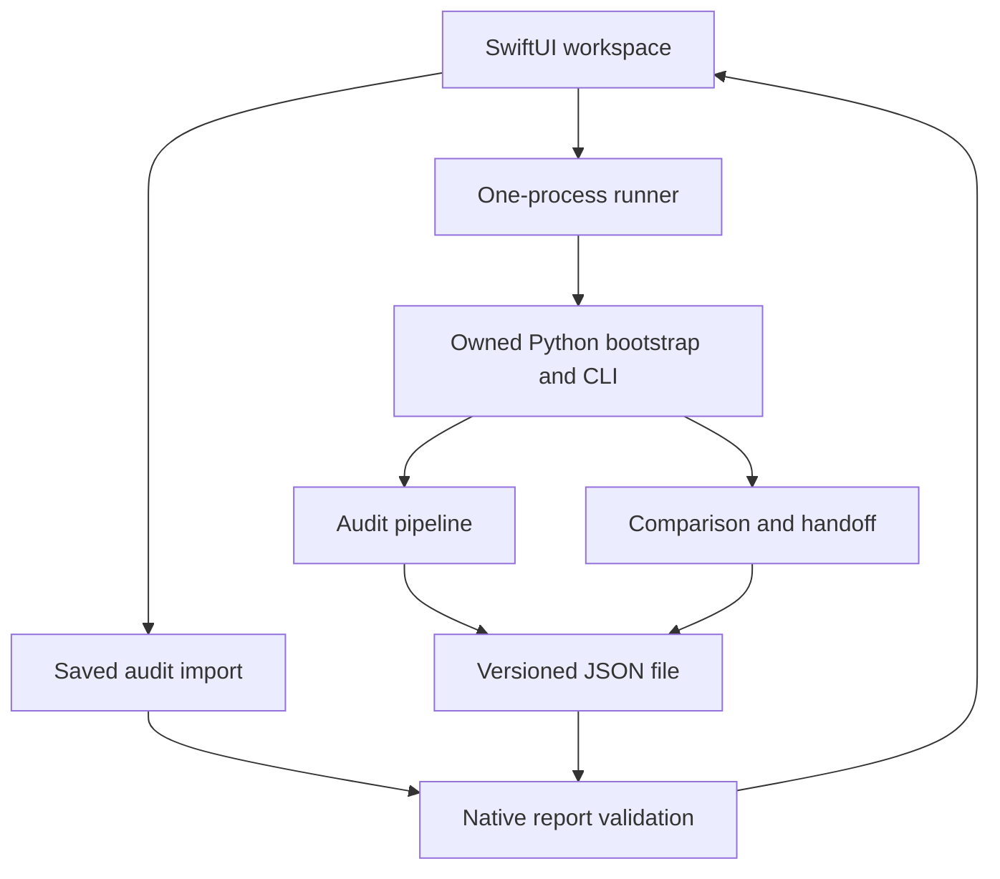

# AIRS architecture

Current-status note: first native/C10 builds and the bounded C13 FDE subset
are now delivered. See C13_RESULTS.md and DWARF_CFI.md; the original architecture
record below includes historical authoring-environment and v1 descriptions.
The current model is `arm64-bounded-cfg-v3`; see C12_RESULTS.md and BOUNDED_CFG.md.

## 1. Delivered system and verification boundary

The starter separates a Python 3.11+ standard-library analysis engine from a
macOS 14+ SwiftUI/AppKit front end. Versioned JSON connects the two. The Python
CLI is useful independently; the native app also opens saved audit reports when
its interpreter or engine cannot be found. Selecting a binary supplies bytes
for inspection. The target is never loaded as executable code. The product
scope is one selected final image per operation, including the principal
executable of a selected `.app`, rather than recursive bundle analysis.
([engine.py](../src/airs/engine.py), [Package.swift](../native/Package.swift))

**The Swift source has not been compiled or run in the current Linux authoring
environment.** Architecture descriptions below describe implemented source and
contracts, not verified Apple SDK, GUI, signing, or timing results. Use
[NATIVE_BUILD.md](NATIVE_BUILD.md) for actual Mac build and interaction checks;
[TEST_STRATEGY.md](TEST_STRATEGY.md) describes the evidence needed for analysis
changes. No native-engine rewrite is required before the first Mac preview.



The file boundary gives the app a complete artifact to validate before changing
its current report. It also supports reproducible CLI use and future alternative
front ends without coupling analysis to a window lifecycle.

## 2. Module responsibilities

| Module | Responsibility and boundary |
| --- | --- |
| [types.py](../src/airs/types.py) | Frozen internal records, preferred-address conventions, limits, input errors, issues, and analysis outcomes. |
| [macho.py](../src/airs/macho.py) | Bounded final-image/FAT parsing, slice identity, sections, symbols, and independently derived function boundaries. |
| [compact.py](../src/airs/compact.py) | Compact-unwind page/table parsing and ordered metadata ranges, including no-rule and DWARF-reference ranges. |
| [arm64.py](../src/airs/arm64.py) | Explicit instruction decoding and symbolic integer/stack state; unknown instruction effects raise model errors. |
| [audit.py](../src/airs/audit.py) | Complete-function eligibility, modeled observations, caller recovery, uncertainty precedence, and evidence retention. |
| [engine.py](../src/airs/engine.py) | Input resolution, function/rule joins, global budgets, deterministic finding identities, and report assembly. |
| [report.py](../src/airs/report.py) | Report validation, bounded JSON serialization/import, escaped static HTML, and protected atomic output. |
| [diff.py](../src/airs/diff.py) | Conservative function matching and comparison of findings, scopes, encodings, and evidence. |
| [bridge.py](../src/airs/bridge.py) | Export-only proposed MacScope handoff and destination-identity predicate. |
| [cli.py](../src/airs/cli.py), [bootstrap](../airs_cli.py) | Command dispatch, process exit/error conventions, and isolated access to the owned engine source. |
| [AuditReport.swift](../native/Sources/AIRSCore/AuditReport.swift), [ComparisonReport.swift](../native/Sources/AIRSCore/ComparisonReport.swift) | Native versioned models, structural validation, bounded reads, and comparison decoding. |
| [EngineConfiguration.swift](../native/Sources/AIRSCore/EngineConfiguration.swift), [EngineRunner.swift](../native/Sources/AIRSCore/EngineRunner.swift) | Interpreter/bootstrap discovery and ownership of one cancellable local process. |
| [AuditWorkspace.swift](../native/Sources/AIRSApp/AuditWorkspace.swift), [AIRSApp.swift](../native/Sources/AIRSApp/AIRSApp.swift) | Main-actor state, file panels, operation identity, exports, commands, settings, and deferred ordinary Quit. |
| [Native views](../native/Sources/AIRSApp) | Report/function navigation, explicit result vocabulary, evidence, comparison, and setup presentation. |

Format parsing is deliberately separate from semantic eligibility. Reading a
valid metadata range does not make its instructions supported, and discovering
a function does not establish an unwind rule. This separation keeps additional
format coverage from silently expanding claims made by the checker.

## 3. Input-to-finding pipeline

Input resolution accepts a regular local file or reads a selected `.app`’s
`CFBundleExecutable` from `Contents/Info.plist`. Bundle resolution is bounded and
checks that the named executable remains inside `Contents/MacOS`. The engine
reads the file with a size ceiling, including a second bound against growth
during reading. The Mach-O parser selects a supported FAT slice when needed,
prefers ordinary ARM64, and records both container and slice identity.
([engine.py](../src/airs/engine.py), [macho.py](../src/airs/macho.py))

Function starts come from `LC_FUNCTION_STARTS`, with weaker symbol provenance
available for display. Compact entries independently describe half-open address
ranges. A rule may cover several functions. The engine uses ordered range
lookup to join each function to a rule, and makes functions crossing multiple
rules unresolved. Metadata entries never manufacture function boundaries.

For eligible functions, the decoder accepts only documented instruction forms
and requires a recognized return with supported trailing padding. The checker
separates setup, body, and teardown; compares frame metadata at supported
direct-call observations; and uses a separately labelled leaf-body comparison
for the supported frameless subset. Unknown required recovery values take
precedence over known discrepancies. The precise ABI, aliasing, return-state,
and observation rules belong in [ANALYSIS_CONTRACT.md](ANALYSIS_CONTRACT.md) and
[DECODER_SCOPE.md](DECODER_SCOPE.md), rather than being redefined by the UI.

## 4. State and outcome contracts

Internal model values represent constants, original register identities,
entry-SP-relative locations, displaced identities, or explicit unknowns. Stack
storage records modeled writes to supported locations. An `AuditResult` keeps
verdict, metadata coverage, mode, scope, checked PCs, reason codes, evidence,
limitations, and instruction count as independent fields.
([arm64.py](../src/airs/arm64.py), [types.py](../src/airs/types.py))

| Outcome class | Architectural meaning |
| --- | --- |
| `InputError` | Input, structural, usage, or resource rejection with a stable code; no complete audit report is substituted. |
| `Issue` | A report-level input/metadata/budget note compatible with continued reporting. |
| Unresolved finding | Required metadata, boundaries, instructions, observations, or resources cannot support a comparison. |
| Supported inconsistency | A complete supported modeled comparison contains a known recovery discrepancy. |
| Agreement within scope | Every required comparison agrees at the justified observations, within the declared model. |

Report import checks internal consistency, not authorship or whether someone
actually ran the analyzer. Supported findings require metadata, checked PCs,
and a semantic scope; supported compact findings require nonzero encodings.
For `arm64-linear-v1`, validators additionally enforce ordinary ARM64, trusted
boundaries, compact coverage, compatible frame/leaf scopes, and supported
encoding fields. Unknown analysis-model strings remain importable under generic
schema checks. Python also rejects duplicate JSON keys and applies per-field
limits; native import is not claimed to duplicate every parser check.
([report.py](../src/airs/report.py), [native validator](../native/Sources/AIRSCore/AuditReport.swift))

## 5. Identity and address spaces

| Value | Interpretation |
| --- | --- |
| Container SHA-256 | Identity of the complete file supplied to the parser. |
| Slice SHA-256 | Identity of the selected Mach-O bytes; central to matching and handoff. |
| UUID | Additional image identity when present; a name or UUID alone does not replace a digest match. |
| Slice offset/size | Integer extent within the original container. |
| Section file offset | Integer offset relative to the selected slice. |
| Preferred VM address | Internal integer, serialized as lowercase hexadecimal; no runtime slide applied. |
| Image-relative offset | Preferred address minus the `__TEXT` segment VM base. |

All function and metadata ranges are `[start, end)`. Parser error offsets inside
a selected image are slice-relative; FAT-directory error offsets refer to the
container. Consumers must retain that context rather than presenting every
offset as a runtime PC. Runtime addresses and slide discovery are outside the
starter’s interpretation. ([types.py](../src/airs/types.py),
[macho.py](../src/airs/macho.py), [ANALYSIS_CONTRACT.md](ANALYSIS_CONTRACT.md))

Finding IDs hash schema version, analysis-model version, slice digest,
architecture, and the preferred function range. They are exact-image evidence
identifiers, not cross-build source identifiers. Renaming a file, changing the
outer FAT container while retaining identical selected bytes, or changing a
resource limit can preserve an ID while changing other report fields.

Comparison uses normalized numeric image offsets for the same slice and
architecture. Across builds it uses unique symbol-name candidates; unnamed or
duplicate candidates remain unmatched or ambiguous. Model compatibility requires
equal model strings and architecture. Differing or one-sided missing
`analysis_config` produces a separate interpretation note, rather than silently
making resource configurations equivalent. ([engine.py](../src/airs/engine.py),
[diff.py](../src/airs/diff.py))

## 6. Process and workspace lifecycle

The native runner launches an explicit interpreter with the owned bootstrap:

```text
python -I <bootstrap> audit --format json --output <private-report> -- <input>
```

`Process.arguments` preserves each path as one argument. Python isolated mode
avoids target-directory/environment import lookup, while the bootstrap adds
only its sibling `src` path and disables bytecode-cache writes. The interpreter
and bootstrap are trusted configured tools; the process boundary is not an OS
sandbox or an execution service for the inspected target.
([EngineRunner.swift](../native/Sources/AIRSCore/EngineRunner.swift),
[bootstrap](../airs_cli.py))

Each invocation owns a random `0700` temporary directory and file-backed stdout
and stderr. Output files avoid an undrained-pipe dependency. The runner waits
for termination, checks status, reads bounded output, and cleans up. Audit exit
0 means report generation succeeded. Exit 1 is reserved for supported
inconsistencies when the explicit CLI CI flag is used; the native app does not
set that flag. Input/usage failures use 2 and unexpected internal failures use
3. A nonzero result or missing output never becomes a displayed audit.
([cli.py](../src/airs/cli.py))

The workspace keeps operation identity, busy state, cancellation availability,
current report/raw bytes, source label, filters, selection, and comparison
state. Reading and decoding use a separate worker actor. Completion applies
only to the active operation; cancellation retains the old report. The runner
owns its child until termination and escalates a pending cancellation after
two seconds only for that child. Atomic user exports settle without a Cancel
affordance. Ordinary Quit defers application exit until work settles. Forced
termination can bypass these cleanup paths; Mac validation remains necessary.
([AuditWorkspace.swift](../native/Sources/AIRSApp/AuditWorkspace.swift),
[AIRSApp.swift](../native/Sources/AIRSApp/AIRSApp.swift))

## 7. Versioning, serialization, and persistence

Three independent identities are exposed: generator release version,
analysis-model version, and report schema version. Audit, comparison, and
handoff documents have distinct `report_kind` values. Schema 1 permits additive
fields; incompatible major schemas are rejected. Changing supported result
semantics requires a model-version decision even when the JSON shape stays the
same. The supplied [schemas](../schemas) and runtime validators serve different
roles: validators also enforce cross-field relationships.

JSON serialization sorts keys, uses deterministic indentation and ASCII
escaping, rejects non-finite numbers, and appends one newline. It counts emitted
chunks before assembling an oversized output. Reproducibility requires the same
bytes, selected architecture, input display name, effective limits, model and
output options. There is no timestamp. A renamed input changes `display_name`;
`--include-path` explicitly adds location-dependent data. Effective limits are
recorded in `analysis_config.limits`. ([report.py](../src/airs/report.py),
[engine.py](../src/airs/engine.py))

The CLI stages output beside its destination, flushes and synchronizes it,
then replaces the destination atomically after checking protected inputs.
Native exports preserve original audit bytes, including unrendered additive
fields. The app retains one report in memory and saves only the interpreter
setting automatically; it has no history database. Static HTML is a separate
escaped CLI rendering. The native app’s interchange/export workflow uses JSON.

## 8. Resource boundaries

The effective defaults in [Limits](../src/airs/types.py) are:

| Resource | Default ceiling |
| --- | ---: |
| Input file | 512 MiB |
| Load commands / sections | 4,096 each |
| Functions / unwind entries | 50,000 / 200,000 |
| Instructions per function / candidate instructions per audit | 16,384 / 1,000,000 |
| Observations per function | 256 |
| Evidence per function / per report | 32 / 8,192 |

Additional parser ceilings are 256 FAT slices, one million symbols, 4,096 bytes
per decoded executable-symbol name, and a 16 MiB aggregate decoded-name budget.
Bundle plist input is limited to 1 MiB. JSON import and generated JSON are
limited to 64 MiB; native diagnostic display reads at most the final 16 KiB.
([macho.py](../src/airs/macho.py), [engine.py](../src/airs/engine.py),
[report.py](../src/airs/report.py), [EngineRunner.swift](../native/Sources/AIRSCore/EngineRunner.swift))

Limits have different outcomes. Structural/parser limits fail the input.
Instruction and global evidence budgets retain affected functions as explicitly
unresolved. Observation exhaustion makes that function unresolved. Retained
evidence can be a labelled sample while all recovery comparisons are still
evaluated; a later unknown must still override an earlier discrepancy. Generated
JSON exceeding its size ceiling fails before output commit.

These are bounded-work and artifact-size controls, not measured peak-RSS,
wall-clock, or disk quotas. The implementation holds input bytes, model objects,
and serialized artifacts in memory; native views add decoded structures.
File-backed diagnostics prevent pipe deadlock but do not establish a separate
log-file quota. Native performance measurements and representative owned-corpus
validation remain release gates.

## 9. Planned extension seams

Future work should extend an explicit boundary:

- **Instruction and rule coverage:** add decoder/state effects and recovery
  rules together with assumptions, counterexamples, and versioned semantics.
- **DWARF and PC-sensitive rules:** introduce their own bounded interpretation
  and observation contracts before replacing unresolved outcomes.
- **Batch/history support:** add image inventory, scheduling, storage, and
  identity-aware selection above the single-image engine API.
- **MacScope adapter:** consume the exported identity/ranges, verify the
  destination, and use a transport confirmed from MacScope’s actual surface.
- **Alternative engine/runtime distribution:** retain versioned artifacts where
  practical; decide on a native port or redistributed Python from measured
  performance and packaging needs.

These seams are planned, not hidden controls or existing services. Priorities
and engineering gates belong in [ROADMAP.md](ROADMAP.md); interaction behavior
is specified in [UX_SPEC.md](UX_SPEC.md). New work must preserve unknown-state
handling, exact-image identity, reproducible reporting, and the distinction
between a supported observation and a whole-image claim.
